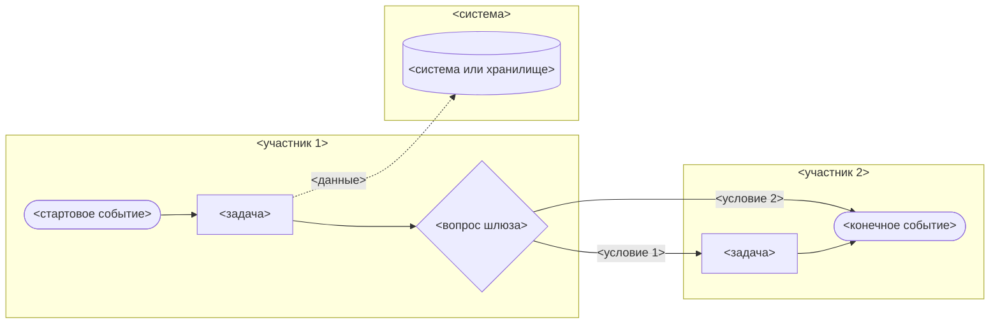

<!-- СГЕНЕРИРОВАНО bin/mirror.js. Не редактировать: правки затрёт следующая генерация.
     Источник правды — domains/<домен>/. -->

# Модель процесса AS-IS и TO-BE

Файл: `<feature>_process-as-is.md`, `<feature>_process-to-be.md` · Владелец: business-analyst

## Назначение

AS-IS фиксирует, как процесс выполняется сейчас, включая ручные обходы и ожидания, и где он теряет время, деньги или клиентов. TO-BE описывает целевой процесс, в котором каждое отличие от AS-IS оформлено изменением `CHG-n` из Gap-анализа и закрывает конкретную проблему. Оба файла строятся по одному шаблону, поэтому их шаги и метрики сравниваются строка к строке.

## Входы

- Артефакты каталога: `_user-story.md`, `_business-case.md`, `_brd.md`, `_gap-analysis.md`, `_stakeholder-map.md`, прошлые версии моделей.
- Регламенты, инструкции, выгрузки и описания систем в файлах проекта.
- Факты, которых нет в источниках, запрашиваются у пользователя одним сообщением:
  1. событие, которое запускает процесс, и результат, которым он заканчивается;
  2. участники: роли, подразделения, внешние участники и системы;
  3. последовательность шагов, точки решений и условия ветвления;
  4. исключения: отказ, возврат на доработку, таймаут, ручной обход;
  5. объёмы и длительности: обращений за период, время шагов и всего цикла, доля ручных операций, доля ошибок и возвратов;
  6. известные проблемы и жалобы клиентов и сотрудников;
  7. для TO-BE: цели изменения, целевые значения метрик, ограничения по срокам, бюджету и регуляторике;
  8. для нового продукта: как клиент решает задачу сегодня.
- `[GAP]` ставится в ячейке шага, метрики или проблемы, где нет факта. Адресаты: пользователь или владелец процесса — шаги, исполнители, объёмы и проблемы; product-owner — цели и целевые значения; system-analyst — поведение существующих систем; комплаенс через `Q-n` — применимость нормативных требований к шагу.

## Шаблон

````markdown
# Процесс <AS-IS | TO-BE>: <название процесса>

| Поле | Значение |
|---|---|
| Feature | `<feature>` |
| Владелец | business-analyst |
| Статус | draft |
| Версия | 0.1 |
| Обновлён | <YYYY-MM-DD> |
| Связанные артефакты | `<файл>`, … |

## Границы процесса

- Триггер начала: <событие>
- Результат конца: <результат для клиента или бизнеса>
- Не входит: <смежные процессы и шаги за границей>

## Исходное состояние

<TO-BE нового продукта: как клиент решает задачу сегодня — решения конкурентов, ручные обходные пути, отказ от задачи. Остальные случаи: «Не применимо: <причина>»>

## Участники

| Участник | Тип | Роль в процессе |
|---|---|---|
| <роль, подразделение, внешний участник или система> | <роль | система | внешний участник> | <что делает> |

## Шаги

| ID | Шаг | Исполнитель | Система | Вход | Выход | Длительность и частота | <AS-IS: Проблемы | TO-BE: Изменение> |
|---|---|---|---|---|---|---|---|
| P-<n> | <глагол + объект> | <участник> | <система или «вручную»> | <данные, документ, событие> | <данные, документ, событие> | <значение из источника или [GAP]> | <AS-IS: проблема или «—» | TO-BE: CHG-<n> или «без изменений»> |

## Схема

Нотация: Mermaid flowchart со swimlane-подграфами. Событие — `([…])`, задача — `[…]`, шлюз — `{…}`, система или хранилище — `[(…)]`, поток между участниками — пунктир.



## Исключения и альтернативные ветки

| Ветка | Условие | Шаги | Чем заканчивается |
|---|---|---|---|
| <название ветки> | <когда возникает> | P-<n> → P-<m> | <возврат к P-<k> или результат> |

## Метрики процесса

| Метрика | Baseline | Целевое значение | Источник |
|---|---|---|---|
| Время цикла | <значение или [GAP]> | <TO-BE: значение или [GAP]; AS-IS: «—»> | <файл или слова пользователя> |
| Доля ручных операций | <значение или [GAP]> | <значение, [GAP] или «—»> | <источник> |
| Доля ошибок и возвратов | <значение или [GAP]> | <значение, [GAP] или «—»> | <источник> |

## <AS-IS: Проблемы и причины | TO-BE: Какие проблемы AS-IS решены>

<AS-IS>
| Проблема | Где проявляется | Причина | Последствие для клиента или бизнеса |
|---|---|---|---|
| <проблема> | P-<n> | <причина или [GAP]> | <последствие> |

<TO-BE>
| Проблема AS-IS | Изменение | Шаги TO-BE | Ожидаемый эффект |
|---|---|---|---|
| <проблема из `<feature>_process-as-is.md`> | <CHG-<n> или «остаётся: <причина>»> | P-<n> | <метрика: baseline → target или [GAP]> |

## Открытые вопросы

| ID | Вопрос | Кому | Где нужен ответ |
|---|---|---|---|
| Q-<n> | <вопрос> | <адресат> | <раздел или P-n> |

## История изменений

| Версия | Дата | Автор | Изменение |
|---|---|---|---|
| 0.1 | <YYYY-MM-DD> | business-analyst | <что сделано> |
````

## Правила

1. Ветка выбирается до заполнения. Процесс уже выполняется — сначала создаётся AS-IS, затем TO-BE. Продукт новый и процесса нет — создаётся только TO-BE с заполненным разделом «Исходное состояние», и выбор ветки называется в резюме ответа.
2. TO-BE и Gap-анализ создаются в одной работе: Gap-анализ выдаёт `CHG-n`, модель TO-BE на них ссылается.
3. Каждая проблема из AS-IS появляется в таблице «Какие проблемы AS-IS решены» модели TO-BE со ссылкой на `CHG-n` или с пометкой «остаётся: <причина>».
4. Название шага — глагол и объект: «Проверить комплектность документов».
5. У шага один исполнитель и одна дорожка на схеме. Действие, которое выполняют два участника, разбивается на два шага с передачей между дорожками.
6. Шаги AS-IS описывают фактическое выполнение: ручные обходы, повторный ввод, ожидание ответа. Расхождение регламента с практикой записывается в колонку «Проблемы» того шага, где оно проявляется.
7. Каждый шаг таблицы есть на схеме, id узла совпадает с ID шага без дефиса: `P-3` → `P3`. Узлы систем и хранилищ получают id `S1`, `S2`, подграфы — `lane1`, `lane2`.
8. У каждого шлюза подписаны все исходящие ветки, и каждая ветка приходит к конечному событию или возвращается к шагу.
9. Подписи узлов, рёбер и подграфов пишутся в двойных кавычках: так кириллица, скобки и знаки препинания не ломают разбор Mermaid.
10. Схема остаётся flowchart со swimlane-подграфами. Запрос на BPMN 2.0 XML для Camunda или bpmn.io оформляется отдельной задачей в блоке «Передача».
11. Длительности, частоты, объёмы и baseline метрик берутся из источников; целевые значения TO-BE — из бизнес-кейса, BRD или слов пользователя.
12. Нумерация `P-n` в AS-IS и TO-BE независима. Ссылка на шаг из другого файла пишется с именем файла: `P-4 (<feature>_process-as-is.md)`.
13. Шаг AS-IS, который выполняется из-за нормативного требования, переходит в TO-BE без изменений или меняется только после подтверждения комплаенса через `Q-n`. Перечень актов для проверки — в правилах `references/ba-brd.md`.

## Чеклист качества

- [ ] Ветка выбрана явно: для существующего процесса есть AS-IS, для нового продукта в TO-BE заполнен раздел «Исходное состояние».
- [ ] Границы процесса содержат триггер начала, результат конца и то, что не входит.
- [ ] Каждый исполнитель и каждая система из таблицы шагов есть в таблице участников и в подграфе схемы.
- [ ] Каждый шаг таблицы есть на схеме с id узла по правилу `P-n` → `Pn`, и каждый узел-задача схемы есть в таблице.
- [ ] У каждого шага один исполнитель.
- [ ] Название каждого шага начинается с глагола.
- [ ] У каждого шлюза подписаны все исходящие ветки.
- [ ] Каждая ветка схемы заканчивается конечным событием или возвратом к шагу.
- [ ] Все подписи узлов, рёбер и подграфов в Mermaid заключены в двойные кавычки.
- [ ] Каждое исключение из таблицы исключений ссылается на существующие шаги и имеет завершение.
- [ ] Каждое значение длительности, частоты и метрики имеет источник или `[GAP]`.
- [ ] AS-IS: у каждой проблемы указан шаг, где она проявляется.
- [ ] TO-BE: каждая проблема AS-IS есть в таблице решённых проблем со ссылкой на `CHG-n` или пометкой «остаётся» с причиной.
- [ ] TO-BE: каждый новый или изменённый шаг ссылается на `CHG-n`, который существует в `_gap-analysis.md`.
- [ ] Каждый `[GAP]` продублирован вопросом `Q-n` с адресатом.
